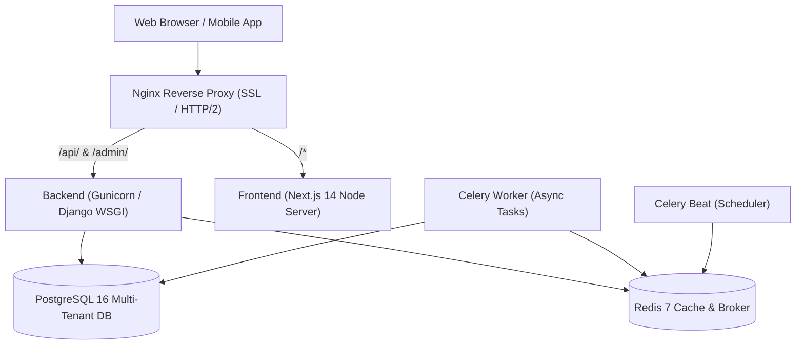

# ShopPilot — Production Deployment & Infrastructure Runbook

**Document Version:** 1.0.0 (Production Ready)  
**Classification:** DevOps & Systems Architecture Manual  
**Target OS:** Linux (Ubuntu 22.04 LTS / Debian 12 / Containerized)  
**Container Engine:** Docker Engine 26+ with Docker Compose v2+

---

## 1. System Architecture

ShopPilot runs as a distributed multi-container application orchestrated via Docker Compose or Kubernetes.



---

## 2. Infrastructure Components

1. **PostgreSQL 16:**
   - Multi-tenant relational storage.
   - Enforces transactional integrity, foreign keys, and row locking (`select_for_update`).
   - Connection pool managed via PgBouncer or Django persistent connections.
2. **Redis 7:**
   - Primary in-memory store for:
     - Celery task broker and results backend.
     - Django caching layer (session cache, feature flags).
     - Global API rate limiting and token blacklisting.
3. **Gunicorn WSGI Server:**
   - 4-8 worker processes (`gunicorn --workers 4 --threads 2 config.wsgi:application`).
   - Sits behind Nginx reverse proxy.
4. **Celery Worker & Beat:**
   - Asynchronous execution of automated workflows, email dispatch, SMS alerts, and RFM recalculation.
5. **Next.js 14 Frontend:**
   - Node 20 LTS standalone server (`node server.js`).
   - Pre-rendered static pages + client-side DRF API integration.

---

## 3. Production Docker Compose Configuration

Create `docker-compose.prod.yml` in project root:

```yaml
version: '3.8'

services:
  db:
    image: postgres:16-alpine
    restart: always
    environment:
      POSTGRES_DB: shoppilot_db
      POSTGRES_USER: shoppilot_user
      POSTGRES_PASSWORD: ${POSTGRES_PASSWORD}
    volumes:
      - postgres_data:/var/lib/postgresql/data
    healthcheck:
      test: ["CMD-SHELL", "pg_isready -U shoppilot_user -d shoppilot_db"]
      interval: 10s
      timeout: 5s
      retries: 5

  redis:
    image: redis:7-alpine
    restart: always
    command: redis-server --appendonly yes --requirepass ${REDIS_PASSWORD}
    volumes:
      - redis_data:/data
    healthcheck:
      test: ["CMD", "redis-cli", "-a", "${REDIS_PASSWORD}", "ping"]
      interval: 10s
      timeout: 5s
      retries: 5

  backend:
    build:
      context: ./backend
      dockerfile: Dockerfile
    restart: always
    command: gunicorn --bind 0.0.0.0:8000 --workers 4 --threads 2 --access-logfile - --error-logfile - config.wsgi:application
    environment:
      DEBUG: "False"
      DJANGO_SECRET_KEY: ${DJANGO_SECRET_KEY}
      DATABASE_URL: postgres://shoppilot_user:${POSTGRES_PASSWORD}@db:5432/shoppilot_db
      REDIS_URL: redis://:${REDIS_PASSWORD}@redis:6379/0
      ALLOWED_HOSTS: ${ALLOWED_HOSTS}
      CORS_ALLOWED_ORIGINS: ${CORS_ALLOWED_ORIGINS}
      GEMINI_API_KEY: ${GEMINI_API_KEY:-}
      KAVENEGAR_API_KEY: ${KAVENEGAR_API_KEY:-}
    depends_on:
      db:
        condition: service_healthy
      redis:
        condition: service_healthy
    volumes:
      - static_volume:/app/staticfiles
      - media_volume:/app/media

  celery_worker:
    build:
      context: ./backend
      dockerfile: Dockerfile
    restart: always
    command: celery -A config worker --loglevel=INFO --concurrency=4
    environment:
      DATABASE_URL: postgres://shoppilot_user:${POSTGRES_PASSWORD}@db:5432/shoppilot_db
      REDIS_URL: redis://:${REDIS_PASSWORD}@redis:6379/0
      DJANGO_SECRET_KEY: ${DJANGO_SECRET_KEY}
    depends_on:
      - backend

  celery_beat:
    build:
      context: ./backend
      dockerfile: Dockerfile
    restart: always
    command: celery -A config beat --loglevel=INFO
    environment:
      DATABASE_URL: postgres://shoppilot_user:${POSTGRES_PASSWORD}@db:5432/shoppilot_db
      REDIS_URL: redis://:${REDIS_PASSWORD}@redis:6379/0
      DJANGO_SECRET_KEY: ${DJANGO_SECRET_KEY}
    depends_on:
      - backend

  frontend:
    build:
      context: ./frontend
      dockerfile: Dockerfile
    restart: always
    environment:
      NEXT_PUBLIC_API_URL: https://${DOMAIN_NAME}/api/v1
      NODE_ENV: production
    depends_on:
      - backend

  nginx:
    image: nginx:1.25-alpine
    restart: always
    ports:
      - "80:80"
      - "443:443"
    volumes:
      - ./nginx/nginx.conf:/etc/nginx/conf.d/default.conf:ro
      - ./nginx/ssl:/etc/nginx/ssl:ro
      - static_volume:/var/www/static:ro
      - media_volume:/var/www/media:ro
    depends_on:
      - frontend
      - backend

volumes:
  postgres_data:
  redis_data:
  static_volume:
  media_volume:
```

---

## 4. Production Nginx Reverse Proxy Configuration

Create `nginx/nginx.conf`:

```nginx
upstream backend_app {
    server backend:8000;
}

upstream frontend_app {
    server frontend:3000;
}

# Redirect HTTP to HTTPS
server {
    listen 80;
    server_name shoppilot.ir www.shoppilot.ir;
    return 301 https://$host$request_uri;
}

server {
    listen 443 ssl http2;
    server_name shoppilot.ir www.shoppilot.ir;

    ssl_certificate /etc/nginx/ssl/fullchain.pem;
    ssl_certificate_key /etc/nginx/ssl/privkey.pem;
    ssl_protocols TLSv1.2 TLSv1.3;
    ssl_ciphers HIGH:!aNULL:!MD5;
    ssl_prefer_server_ciphers on;

    # Security Headers
    add_header X-Content-Type-Options "nosniff" always;
    add_header X-Frame-Options "SAMEORIGIN" always;
    add_header X-XSS-Protection "1; mode=block" always;
    add_header Strict-Transport-Security "max-age=31536000; includeSubDomains; preload" always;
    add_header Referrer-Policy "strict-origin-when-cross-origin" always;

    # Gzip Compression
    gzip on;
    gzip_types text/plain text/css application/json application/javascript text/xml application/xml application/xml+rss text/javascript;

    # Static & Media Assets
    location /static/ {
        alias /var/www/static/;
        expires 30d;
        add_header Cache-Control "public, max-age=2592000, immutable";
    }

    location /media/ {
        alias /var/www/media/;
        expires 7d;
        add_header Cache-Control "public, max-age=604800";
    }

    # API & Django Admin Reverse Proxy
    location ~ ^/(api|admin)/ {
        proxy_pass http://backend_app;
        proxy_set_header Host $host;
        proxy_set_header X-Real-IP $remote_addr;
        proxy_set_header X-Forwarded-For $proxy_add_x_forwarded_for;
        proxy_set_header X-Forwarded-Proto $scheme;
        proxy_connect_timeout 60s;
        proxy_read_timeout 60s;
        client_max_body_size 25M;
    }

    # Next.js Frontend
    location / {
        proxy_pass http://frontend_app;
        proxy_set_header Host $host;
        proxy_set_header X-Real-IP $remote_addr;
        proxy_set_header X-Forwarded-For $proxy_add_x_forwarded_for;
        proxy_set_header X-Forwarded-Proto $scheme;
        proxy_http_version 1.1;
        proxy_set_header Upgrade $http_upgrade;
        proxy_set_header Connection 'upgrade';
        proxy_cache_bypass $http_upgrade;
    }
}
```

---

## 5. Deployment & Migration Runbook

### Step 1: Pre-flight Environment Checklist
Ensure `.env` contains:
```bash
DJANGO_SECRET_KEY=<cryptographically-random-50-character-key>
POSTGRES_PASSWORD=<secure-db-password>
REDIS_PASSWORD=<secure-redis-password>
ALLOWED_HOSTS=shoppilot.ir,www.shoppilot.ir
CORS_ALLOWED_ORIGINS=https://shoppilot.ir,https://www.shoppilot.ir
DOMAIN_NAME=shoppilot.ir
GEMINI_API_KEY=<optional-gemini-key>
KAVENEGAR_API_KEY=<optional-kavenegar-key>
```

### Step 2: Build & Start Services
```bash
docker compose -f docker-compose.prod.yml build
docker compose -f docker-compose.prod.yml up -d db redis
# Wait for healthy database
docker compose -f docker-compose.prod.yml up -d backend
```

### Step 3: Run Database Migrations & Collect Static
```bash
docker compose -f docker-compose.prod.yml exec backend python manage.py migrate --noinput
docker compose -f docker-compose.prod.yml exec backend python manage.py collectstatic --noinput
```

### Step 4: Seed Initial Superuser or Demo Store (If New Installation)
```bash
docker compose -f docker-compose.prod.yml exec backend python manage.py seed_demo_data
```

### Step 5: Start Remainder of Stack
```bash
docker compose -f docker-compose.prod.yml up -d
```

---

## 6. Backup & Disaster Recovery Procedures

### 6.1 Automated Daily PostgreSQL Dump
Schedule via host crontab (`0 3 * * *`):
```bash
#!/bin/bash
BACKUP_DIR="/var/backups/shoppilot"
TIMESTAMP=$(date +"%Y%m%d_%H%M%S")
mkdir -p "$BACKUP_DIR"

docker exec $(docker ps -qf "name=db") pg_dump -U shoppilot_user -d shoppilot_db -Fc > "$BACKUP_DIR/db_$TIMESTAMP.dump"
gzip -9 "$BACKUP_DIR/db_$TIMESTAMP.dump"

# Keep last 14 days of backups
find "$BACKUP_DIR" -type f -name "*.dump.gz" -mtime +14 -delete
```

### 6.2 Restoration Procedure
```bash
# 1. Stop backend services
docker compose -f docker-compose.prod.yml stop backend celery_worker celery_beat

# 2. Drop and recreate database
docker exec -i $(docker ps -qf "name=db") dropdb -U shoppilot_user shoppilot_db
docker exec -i $(docker ps -qf "name=db") createdb -U shoppilot_user shoppilot_db

# 3. Restore from dump
gunzip -c /var/backups/shoppilot/db_TARGET_TIMESTAMP.dump.gz | docker exec -i $(docker ps -qf "name=db") pg_restore -U shoppilot_user -d shoppilot_db

# 4. Restart services
docker compose -f docker-compose.prod.yml start backend celery_worker celery_beat
```
