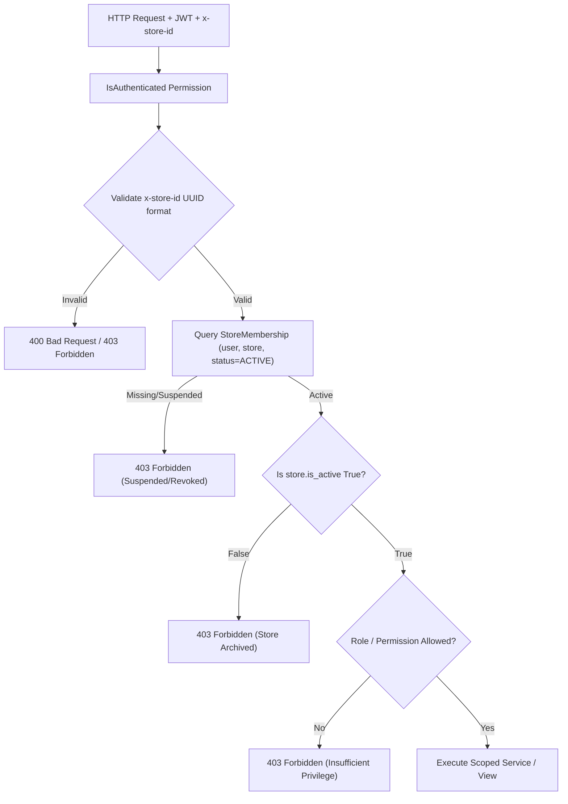

# ShopPilot — Security Architecture & Multi-Tenancy Specification

**Document Version:** 1.0.0 (Production Hardened)  
**Classification:** Technical Architecture & Security Manual  
**Applies to:** Backend (`apps/tenancy`, `apps/accounts`, `apps/audit`, `apps/payments`, `config/settings.py`)

---

## 1. Architectural Overview

ShopPilot implements a **shared-database, isolated-schema/tenant-scoped** multi-tenant SaaS architecture. All business records inherit from `TenantScopedModel` or maintain a foreign key to `apps.tenancy.models.Store`.

Data separation is enforced at multiple defense layers:
1. **Network & Header Protocol:** The client passes `x-store-id: <uuid>` with every request.
2. **Context Resolution Middleware & Permissions:** In `apps.tenancy.permissions.py`, `get_request_store` resolves and validates tenant context fail-closed before any business logic executes.
3. **Queryset Tenant Scoping:** Views override `get_queryset()` to filter by `store=request.store`.
4. **Mutating Operation Binding:** Viewset `perform_create` methods explicitly inject `store=request.store` from the authenticated request rather than accepting client-supplied store identifiers.



---

## 2. Fail-Closed Tenancy Resolution

### 2.1 The `get_request_store` Protocol

Located in `backend/apps/tenancy/permissions.py`:

```python
def get_request_store(request):
    """
    Safely resolves and caches the store context for the current request.
    Enforces UUID format validation, membership active status, and store activation.
    Fails closed (returns None) if any security invariant is violated.
    """
    if hasattr(request, '_cached_store'):
        return request._cached_store

    store_id = request.headers.get('x-store-id') or request.query_params.get('store_id')
    if not store_id:
        request._cached_store = None
        return None

    # Defense 1: Reject malformed UUIDs
    try:
        store_uuid = uuid.UUID(str(store_id))
    except (ValueError, TypeError, AttributeError):
        request._cached_store = None
        return None

    # Defense 2: Unauthenticated users have no store context
    if not request.user or not request.user.is_authenticated:
        request._cached_store = None
        return None

    # Defense 3: Look up active membership
    try:
        from apps.tenancy.models import StoreMembership, MembershipStatus
        membership = StoreMembership.objects.select_related('store').get(
            user=request.user,
            store_id=store_uuid,
            is_active=True,
            status=MembershipStatus.ACTIVE,
            store__is_active=True
        )
        request._cached_store = membership.store
        request._cached_membership = membership
        return membership.store
    except StoreMembership.DoesNotExist:
        request._cached_store = None
        return None
```

### 2.2 Security Invariants Enforced
- **Suspension Enforcement:** Users whose membership status is changed to `SUSPENDED`, `REVOKED`, or `EXPIRED` immediately lose all API access across every module (orders, payments, tasks, settings).
- **Store Archival Isolation:** If a store is marked `is_active=False` (e.g. following account closure or subscription termination), requests targeting it are rejected fail-closed.
- **Header Spoofing Prevention:** Supplying a random or unauthorized store UUID returns `403 Forbidden` because no matching `StoreMembership(user=request.user, store_id=uuid, status=ACTIVE)` exists.

---

## 3. Role-Based Access Control (RBAC) Hierarchy

ShopPilot enforces a granular role hierarchy defined in `apps.tenancy.models.Role`:

| Role | Hierarchy Level | Capabilities & Permissions | Restrictions |
| :--- | :---: | :--- | :--- |
| `OWNER` | 1 | Full business & financial authority; billing, ownership transfer, store deletion, staff management. | Cannot be invited via team invitation API. Cannot demote last owner. |
| `ADMIN` | 2 | Store settings, team management (except owner promotion), catalog, orders, payments verification. | Cannot transfer business ownership or delete store. |
| `BUSINESS_MANAGER` | 3 | Financial reports, analytics, pricing, discount campaigns, B2B wholesale client approval. | Cannot modify staff permissions or alter store architecture. |
| `OPS_MANAGER` | 4 | Day-to-day warehouse operations, shipments, supplier purchase orders, fulfillment, task assignments. | No financial statement export or gateway reconfiguration. |
| `INVENTORY_MANAGER` | 5 | Stock balances, stock adjustments, warehouse transfers, receiving PO goods, barcode auditing. | Cannot access customer CRM or financial settlements. |
| `CONTENT_CREATOR` | 6 | Social media content authoring, post drafts, reels publishing calendar, marketing captions. | Read-only on catalog; blocked from financial and customer contact data. |
| `READ_ONLY` | 7 | View-only dashboard analytics and report inspection. | All mutating methods (`POST`, `PUT`, `PATCH`, `DELETE`) rejected with 403. |

---

## 4. Privilege Escalation Defenses

### 4.1 Owner Immutability in Invitations
Ordinary team invitations cannot grant `Role.OWNER`. In `backend/apps/tenancy/serializers.py`:

```python
class TeamInvitationSerializer(serializers.ModelSerializer):
    def validate_role(self, value):
        if value == Role.OWNER:
            raise serializers.ValidationError(
                "نقش مالک (OWNER) از طریق دعوت‌نامه تیمی قابل واگذاری نیست. "
                "جهت انتقال مالکیت فروشگاه، از فرآیند انتقال رسمی مالکیت استفاده نمایید."
            )
        return value
```

### 4.2 Last-Owner Protection
A store must always retain at least one active owner. In `backend/apps/tenancy/serializers.py`:

```python
class StoreMembershipSerializer(serializers.ModelSerializer):
    def validate_role(self, value):
        instance = getattr(self, 'instance', None)
        if instance and instance.role == Role.OWNER and value != Role.OWNER:
            active_owners_count = StoreMembership.objects.filter(
                store=instance.store,
                role=Role.OWNER,
                status=MembershipStatus.ACTIVE,
                is_active=True
            ).exclude(id=instance.id).count()

            if active_owners_count == 0:
                raise serializers.ValidationError(
                    "امکان تغییر نقش یا تنزل آخرین مالک فعال فروشگاه وجود ندارد. "
                    "ابتدا کاربر دیگری را به عنوان مالک تعیین نمایید."
                )
        return value
```

### 4.3 Safe Ownership Transfer
Store ownership transfer is exposed only through a dedicated owner action requiring explicit owner authentication and atomic transaction execution:
1. Authenticates current user is `Role.OWNER`.
2. Locates target active member.
3. Promotes target member to `Role.OWNER`.
4. Demotes former owner to `Role.ADMIN`.
5. Emits an immutable audit log entry `OWNERSHIP_TRANSFERRED`.

---

## 5. Team Invitation Security Lifecycle

### 5.1 Entropy and Single-Use Token Semantics
- Tokens are generated using Python's `secrets.token_urlsafe(32)` yielding 256 bits of cryptographic entropy.
- Invitations carry a strict expiration timestamp (`expires_at = now + 7 days`).
- Invitation lookup uses indexed tokens (`db_index=True`).

### 5.2 Email Identity Binding & Anti-Replay
Previous vulnerability: An authenticated user could click another person's invite URL and join the business.  
Remediation in `backend/apps/tenancy/views.py`:

```python
with transaction.atomic():
    invitation = TeamInvitation.objects.select_for_update().get(token=token)

    # Cryptographic & Identity Binding
    if invitation.email.strip().lower() != request.user.email.strip().lower():
        return Response({
            'error': 'این دعوت‌نامه برای ایمیل دیگری صادر شده است و با حساب کاربری فعلی شما مطابقت ندارد.'
        }, status=status.HTTP_403_FORBIDDEN)

    if invitation.status != InvitationStatus.PENDING:
        return Response({'error': 'این دعوت‌نامه قبلاً استفاده یا لغو شده است.'}, status=status.HTTP_400_BAD_REQUEST)

    if invitation.expires_at < timezone.now():
        invitation.status = InvitationStatus.EXPIRED
        invitation.save(update_fields=['status'])
        return Response({'error': 'مهلت استفاده از این دعوت‌نامه به پایان رسیده است.'}, status=status.HTTP_400_BAD_REQUEST)

    # Atomically accept and create/activate membership
    StoreMembership.objects.update_or_create(
        store=invitation.store,
        user=request.user,
        defaults={'role': invitation.role, 'status': MembershipStatus.ACTIVE, 'is_active': True}
    )
    invitation.status = InvitationStatus.ACCEPTED
    invitation.save(update_fields=['status'])
```

---

## 6. Financial & Payment Verification Security

Payment transactions (`PaymentTransaction`) require administrative authorization before marking orders as paid or releasing escrowed balances:
- The `/api/v1/payments/{id}/verify/` and `/api/v1/payments/{id}/reject/` actions verify that `request.user` has `Role.OWNER`, `Role.ADMIN`, `Role.BUSINESS_MANAGER`, or specific permission `payments.verify`.
- Non-administrative roles (e.g. `CONTENT_CREATOR`, `READ_ONLY`) are rejected with `403 Forbidden`.
- Verified transactions lock rows using `select_for_update()` to prevent concurrent double-credit.

---

## 7. CSV Formula Injection Defense

CSV exports (Audit Logs, Financial Statements, Customer Exports) are protected against **CSV Injection (Formula Injection)** attacks where malicious actors submit text starting with `=`, `+`, `-`, or `@` to trigger arbitrary command execution or DDE attacks when opened in Microsoft Excel or LibreOffice Calc.

Implemented in `backend/apps/audit/views.py` and `backend/apps/finance/views.py`:

```python
def sanitize_csv_value(val):
    """
    Prevents CSV Formula Injection (CWE-1236) by prepending a single quote
    to strings starting with formula characters (=, +, -, @).
    """
    if val is None:
        return ''
    str_val = str(val)
    if str_val and str_val[0] in ('=', '+', '-', '@'):
        return "'" + str_val
    return str_val
```

Furthermore, all CSV responses output a **UTF-8 Byte Order Mark (`\ufeff`)** as the initial byte stream to ensure proper Persian text display without character corruption in Excel.

---

## 8. Summary Checklist for Production Deployment

- [x] JWT tokens rotated via `/api/v1/auth/token/refresh/` with short-lived access tokens (15-60 min).
- [x] All database mutations scoped to `request.store` resolved fail-closed.
- [x] Role transitions validated against owner immutability rules.
- [x] CSV exports sanitized against formula injection.
- [x] Suspended memberships immediately lose API privileges.
- [x] Sensitive actions logged to immutable `AuditLog` table.
